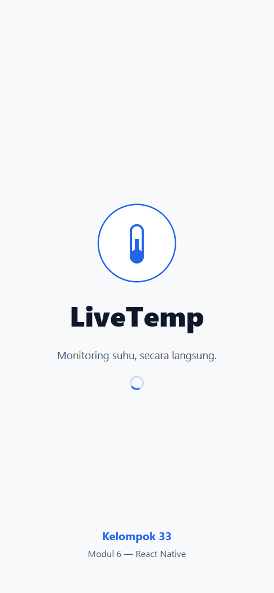
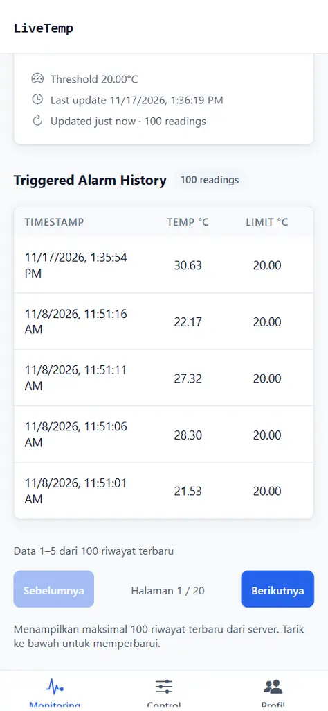
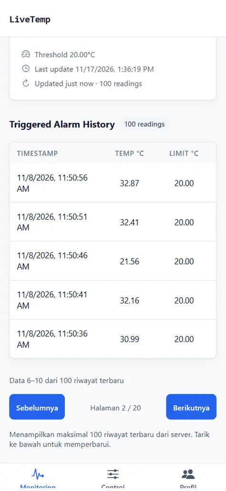
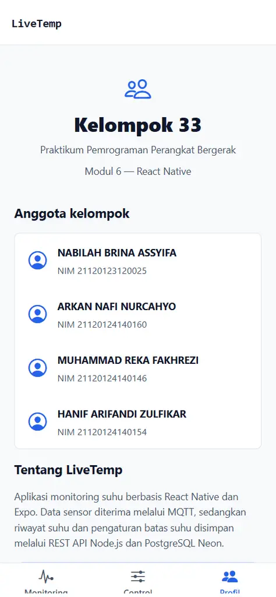
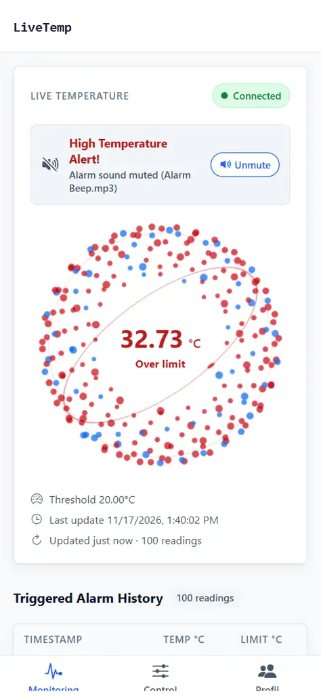

# Tugas Modul 6 — React Native

Kelompok 33 — LiveTemp

Semua path relatif terhadap `Percobaan/PPB-Modul6`. Aplikasi aktif berada di `app`, bukan `frontend-source`. File sudah dimodifikasi langsung. Kode di bawah mendokumentasikan penambahan/perubahan; jangan membuat ulang project dari nol.

## 7.6.1 Splash Screen

### `app/src/screens/SplashScreen.js`

File baru — isi lengkap.

```javascript
import { ActivityIndicator, StyleSheet, Text, View } from "react-native";
import { group } from "../data/group.js";
import { tokens } from "../theme/tokens.js";

const { color, space } = tokens;

export function SplashScreen() {
  return (
    <View style={styles.screen}>
      <View style={styles.brand}>
        <View style={styles.logo}>
          <View style={styles.thermometer}>
            <View style={styles.mercury} />
            <View style={styles.bulb} />
          </View>
        </View>
        <Text style={styles.title}>LiveTemp</Text>
        <Text style={styles.subtitle}>Monitoring suhu, secara langsung.</Text>
        <ActivityIndicator
          size="small"
          color={color.primary}
          accessibilityLabel="Membuka LiveTemp"
        />
      </View>
      <View style={styles.footer}>
        <Text style={styles.group}>{group.name}</Text>
        <Text style={styles.module}>{group.module}</Text>
      </View>
    </View>
  );
}

const styles = StyleSheet.create({
  screen: {
    flex: 1,
    backgroundColor: color.bg,
    alignItems: "center",
    justifyContent: "center",
    padding: space.xxl,
  },
  brand: { alignItems: "center", gap: space.xl },
  logo: {
    width: 112,
    height: 112,
    borderRadius: 56,
    borderWidth: 2,
    borderColor: color.primary,
    backgroundColor: color.surface,
    alignItems: "center",
    justifyContent: "center",
  },
  thermometer: {
    width: 20,
    height: 54,
    borderWidth: 3,
    borderColor: color.primary,
    borderRadius: 10,
  },
  mercury: {
    position: "absolute",
    bottom: 0,
    left: 4,
    width: 6,
    height: 30,
    backgroundColor: color.primary,
  },
  bulb: {
    position: "absolute",
    bottom: -5,
    left: -3,
    width: 20,
    height: 20,
    borderRadius: 10,
    backgroundColor: color.primary,
  },
  title: { fontSize: 40, fontWeight: "800", color: color.text },
  subtitle: { fontSize: 15, color: color.text2, textAlign: "center" },
  footer: { position: "absolute", bottom: 48, alignItems: "center", gap: 6 },
  group: { fontSize: 16, fontWeight: "700", color: color.primary },
  module: { fontSize: 13, color: color.text2 },
});
```


### `app/App.js`

Integrasi — isi lengkap setelah perubahan. Tab Profil di file ini juga dipakai untuk poin 7.6.3.

```javascript
import { useEffect, useState } from "react";
import { NavigationContainer, DefaultTheme } from "@react-navigation/native";
import { createBottomTabNavigator } from "@react-navigation/bottom-tabs";
import Ionicons from "@expo/vector-icons/Ionicons";
import { enableScreens } from "react-native-screens";
import { SafeAreaProvider } from "react-native-safe-area-context";
import { MonitoringScreen } from "./src/screens/MonitoringScreen.js";
import { ControlScreen } from "./src/screens/ControlScreen.js";
import { SplashScreen } from "./src/screens/SplashScreen.js";
import { ProfileScreen } from "./src/screens/ProfileScreen.js";
import { assertConfig } from "./src/services/config.js";
import { AlarmProvider } from "./src/context/AlarmContext.js";
import { tokens } from "./src/theme/tokens.js";

const Tab = createBottomTabNavigator();
const { color } = tokens;

enableScreens(true);

export default function App() {
  const [showSplash, setShowSplash] = useState(true);

  useEffect(() => {
    assertConfig();
    const timer = setTimeout(() => setShowSplash(false), 2400);
    return () => clearTimeout(timer);
  }, []);

  const theme = {
    ...DefaultTheme,
    colors: {
      ...DefaultTheme.colors,
      background: color.bg,
      card: color.surface,
      text: color.text,
      border: color.border,
      primary: color.primary,
    },
  };

  return (
    <SafeAreaProvider>
      {showSplash ? (
        <SplashScreen />
      ) : (
      <AlarmProvider>
        <NavigationContainer theme={theme}>
          <Tab.Navigator
            screenOptions={({ route }) => ({
              headerShown: true,
              headerTitle: "LiveTemp",
              headerTitleAlign: "left",
              headerTintColor: color.text,
              headerStyle: {
                backgroundColor: color.surface,
                borderBottomWidth: 1,
                borderBottomColor: color.border,
              },
              headerTitleStyle: {
                fontWeight: "600",
                fontSize: 17,
                // ponytail: system monospace, no custom font dep
                fontFamily: "monospace",
                letterSpacing: -0.5,
              },
              tabBarActiveTintColor: color.primary,
              tabBarInactiveTintColor: color.text2,
              tabBarLabelStyle: { fontSize: 12, fontWeight: "500" },
              tabBarStyle: {
                backgroundColor: color.surface,
                borderTopWidth: 1,
                borderTopColor: color.border,
              },
              tabBarHideOnKeyboard: true,
              tabBarIcon: ({ color: iconColor }) => {
                const iconName = {
                  Monitoring: "pulse",
                  Control: "options",
                  Profil: "people",
                }[route.name];
                return <Ionicons name={iconName} size={24} color={iconColor} />;
              },
            })}
          >
            <Tab.Screen name="Monitoring" component={MonitoringScreen} />
            <Tab.Screen name="Control" component={ControlScreen} />
            <Tab.Screen name="Profil" component={ProfileScreen} />
          </Tab.Navigator>
        </NavigationContainer>
      </AlarmProvider>
      )}
    </SafeAreaProvider>
  );
}
```


**Analisis:** Splash custom menampilkan logo termometer, LiveTemp, indikator pembukaan aplikasi, dan identitas Kelompok 33. Logo dibentuk menggunakan `View` sehingga tidak perlu menunggu font ikon dimuat. State `showSplash` pada `App.js` menentukan tampilan awal; setelah 2.400 milidetik, timer mengubah state sehingga navigator utama ditampilkan. Cleanup `useEffect` membersihkan timer saat komponen dilepas. Perpindahan tidak menunggu koneksi API sehingga backend yang tidak aktif tidak membuat aplikasi tertahan di splash. Implementasi ini adalah splash pada lapisan React Native sesudah JavaScript berjalan, bukan penggantian launch screen native milik sistem operasi atau Expo Go.

**Bagian yang di-screenshot:** tutup lalu buka ulang aplikasi atau lakukan Reload di Expo Go. Ambil gambar dalam 2,4 detik pertama, ketika termometer, tulisan LiveTemp, dan Kelompok 33 terlihat. Sekadar berpindah tab tidak memunculkan splash lagi.



## 7.6.2 Fitur Pagination

### `app/src/screens/MonitoringScreen.js`

Konstanta sesudah deklarasi `tokens`.

```javascript
const PAGE_SIZE = 5;
```


### `app/src/screens/MonitoringScreen.js`

Tambahan di dalam `MonitoringScreen`. `orbSize` pada blok ini digunakan untuk poin 7.6.4.

```javascript
const [page, setPage] = useState(1);
	const [orbSize, setOrbSize] = useState(280);
	const totalPages = Math.max(1, Math.ceil(readings.length / PAGE_SIZE));
	const visibleReadings = useMemo(
		() => readings.slice((page - 1) * PAGE_SIZE, page * PAGE_SIZE),
		[readings, page],
	);
```


### `app/src/screens/MonitoringScreen.js`

Pada blok `try` fungsi `fetchReadings`, reset halaman setelah pengambilan data berhasil.

```javascript
setReadings(history ?? []);
setPage(1);
```


### `app/src/screens/MonitoringScreen.js`

Tabel menggunakan `visibleReadings` dan diikuti kontrol pagination. Blok ini menggantikan tabel lama sampai sebelum penutup `ScrollView`.

```javascript
<DataTable
					columns={[
						{
							key: "recorded_at",
							title: "Timestamp",
							flex: 1.5,
							// ponytail: same single-line format as threshold history
							render: (value) =>
								value ? new Date(value).toLocaleString() : "--",
						},
						{
							key: "temperature",
							title: "Temp °C",
							flex: 0.9,
							numeric: true,
							render: (value) =>
								typeof value === "number" ? Number(value).toFixed(2) : "--",
						},
						{
							key: "threshold_value",
							title: "Limit °C",
							flex: 0.9,
							numeric: true,
							render: (value) =>
								typeof value === "number" ? Number(value).toFixed(2) : "--",
						},
					]}
					data={visibleReadings}
					keyExtractor={(item) => item.id}
					loading={loading && !refreshing}
					emptyTitle="No readings yet"
					emptyMessage="Triggered readings appear here. Pull to refresh."
					emptyActionLabel="Refresh"
					onEmptyAction={fetchReadings}
				/>
				<Text style={styles.metaText} accessibilityLiveRegion="polite">
					{readings.length === 0
						? "Belum ada data"
						: `Data ${(page - 1) * PAGE_SIZE + 1}–${Math.min(page * PAGE_SIZE, readings.length)} dari ${readings.length} riwayat terbaru`}
				</Text>
				<View style={styles.pagination}>
					<Pressable
						accessibilityRole="button"
						accessibilityLabel="Sebelumnya"
						disabled={page === 1 || loading || refreshing}
						onPress={() => setPage((current) => Math.max(1, current - 1))}
						style={({ pressed }) => [
							styles.pageButton,
							(page === 1 || loading || refreshing) && styles.pageDisabled,
							pressed && styles.pressed,
						]}
					>
						<Text style={styles.pageButtonText}>Sebelumnya</Text>
					</Pressable>
					<Text style={styles.pageLabel} accessibilityLiveRegion="polite">
						Halaman {page} / {totalPages}
					</Text>
					<Pressable
						accessibilityRole="button"
						accessibilityLabel="Berikutnya"
						disabled={page >= totalPages || loading || refreshing}
						onPress={() => setPage((current) => Math.min(totalPages, current + 1))}
						style={({ pressed }) => [
							styles.pageButton,
							(page >= totalPages || loading || refreshing) && styles.pageDisabled,
							pressed && styles.pressed,
						]}
					>
						<Text style={styles.pageButtonText}>Berikutnya</Text>
					</Pressable>
				</View>
				<Text style={styles.metaText}>
					Menampilkan maksimal 100 riwayat terbaru dari server. Tarik ke bawah untuk memperbarui.
				</Text>
```


### `app/src/screens/MonitoringScreen.js`

Tambahkan properti ini ke objek `styles` yang sudah ada; bukan mengganti semua style.

```javascript
pagination: {
		flexDirection: "row",
		flexWrap: "wrap",
		alignItems: "center",
		justifyContent: "space-between",
		gap: space.sm,
	},
	pageButton: {
		minHeight: tokens.hit,
		paddingHorizontal: space.md,
		justifyContent: "center",
		backgroundColor: color.primary,
		borderRadius: radius.input,
	},
	pageButtonText: { color: color.onPrimary, fontSize: 13, fontWeight: "600" },
	pageDisabled: { opacity: 0.4 },
	pageLabel: { color: color.text2, fontSize: 13, fontVariant: ["tabular-nums"] },
```


**Analisis:** Riwayat dibagi menjadi lima baris per halaman melalui `slice`, dengan indeks awal `(page - 1) * PAGE_SIZE` dan indeks akhir `page * PAGE_SIZE`. Jumlah halaman dihitung menggunakan `Math.ceil` agar sisa data di halaman terakhir tetap dapat ditampilkan. `useMemo` menghitung ulang potongan hanya ketika riwayat atau halaman berubah. Sebelumnya nonaktif pada halaman pertama, Berikutnya nonaktif pada halaman terakhir, dan kedua tombol nonaktif ketika data sedang dimuat. Callback `setPage` juga membatasi nilainya agar tidak keluar dari rentang. Refresh yang berhasil dan fokus ulang Monitoring mengembalikan halaman ke 1. Untuk data kosong, halaman tetap 1/1 dengan kedua tombol nonaktif. Backend bawaan hanya mengembalikan maksimal 100 riwayat terbaru; pagination ini mempertahankan batas tersebut dan mencantumkannya di UI, bukan mengklaim menavigasi seluruh isi database.

**Bagian yang di-screenshot:** scroll Monitoring hingga tabel, rentang data, nomor halaman, dan kedua tombol terlihat. Ambil gambar pertama pada halaman 1 (data 1–5, Sebelumnya nonaktif). Tekan Berikutnya dan ambil gambar kedua pada halaman 2 (data 6–10, isi tabel berbeda). Di video, tekan Sebelumnya untuk membuktikan navigasi balik.





## 7.6.3 Halaman Profil

### `app/src/data/group.js`

File baru — identitas bersama untuk splash dan Profil.

```javascript
export const group = {
  name: "Kelompok 33",
  course: "Praktikum Pemrograman Perangkat Bergerak",
  module: "Modul 6 — React Native",
  repository: "https://github.com/RekaFakhrezi/Tugas-Modul-6-Kel33",
  members: [
    { nim: "21120123120025", name: "NABILAH BRINA ASSYIFA" },
    { nim: "21120124140160", name: "ARKAN NAFI NURCAHYO" },
    { nim: "21120124140146", name: "MUHAMMAD REKA FAKHREZI" },
    { nim: "21120124140154", name: "HANIF ARIFANDI ZULFIKAR" },
  ],
};
```


### `app/src/screens/ProfileScreen.js`

File baru — isi lengkap.

```javascript
import { useState } from "react";
import { Linking, Pressable, ScrollView, StyleSheet, Text, View } from "react-native";
import Ionicons from "@expo/vector-icons/Ionicons";
import { group } from "../data/group.js";
import { tokens } from "../theme/tokens.js";

const { color, space, radius } = tokens;

export function ProfileScreen() {
  const [linkError, setLinkError] = useState(null);

  async function openRepository() {
    setLinkError(null);
    try {
      await Linking.openURL(group.repository);
    } catch {
      setLinkError(`Tidak dapat membuka browser. Buka ${group.repository}`);
    }
  }

  return (
    <ScrollView contentContainerStyle={styles.container}>
      <View style={styles.header}>
        <Ionicons name="people-outline" size={40} color={color.primary} />
        <Text style={styles.title}>{group.name}</Text>
        <Text style={styles.description}>{group.course}</Text>
        <Text style={styles.description}>{group.module}</Text>
      </View>
      <Text style={styles.sectionTitle}>Anggota kelompok</Text>
      <View style={styles.members}>
        {group.members.map((member) => (
          <View key={member.nim} style={styles.member}>
            <Ionicons name="person-circle-outline" size={32} color={color.primary} />
            <View style={styles.identity}>
              <Text style={styles.name}>{member.name}</Text>
              <Text selectable style={styles.nim}>NIM {member.nim}</Text>
            </View>
          </View>
        ))}
      </View>
      <Text style={styles.sectionTitle}>Tentang LiveTemp</Text>
      <Text style={styles.description}>
        Aplikasi monitoring suhu berbasis React Native dan Expo. Data sensor
        diterima melalui MQTT, sedangkan riwayat suhu dan pengaturan batas suhu
        disimpan melalui REST API Node.js dan PostgreSQL Neon.
      </Text>
      <Pressable
        onPress={openRepository}
        accessibilityRole="link"
        accessibilityLabel="Buka repository GitHub Kelompok 33"
        style={({ pressed }) => [styles.repository, pressed && { opacity: 0.7 }]}
      >
        <Ionicons name="logo-github" size={22} color={color.onPrimary} />
        <Text style={styles.repositoryText}>Repository GitHub</Text>
      </Pressable>
      {linkError ? <Text accessibilityRole="alert" style={styles.error}>{linkError}</Text> : null}
    </ScrollView>
  );
}

const styles = StyleSheet.create({
  container: { flexGrow: 1, padding: space.xl, gap: space.lg, backgroundColor: color.bg },
  header: { alignItems: "center", gap: space.sm, paddingVertical: space.xl },
  title: { fontSize: 28, fontWeight: "800", color: color.text },
  sectionTitle: { fontSize: 18, fontWeight: "700", color: color.text },
  description: { fontSize: 14, lineHeight: 22, color: color.text2 },
  members: { backgroundColor: color.surface, borderRadius: radius.card, borderWidth: 1, borderColor: color.border },
  member: { flexDirection: "row", alignItems: "center", gap: space.md, padding: space.lg },
  identity: { flex: 1, gap: 6 },
  name: { fontSize: 14, fontWeight: "700", lineHeight: 21, color: color.text },
  nim: { fontSize: 13, color: color.text2 },
  repository: { minHeight: tokens.hit, flexDirection: "row", alignItems: "center", justifyContent: "center", gap: space.sm, backgroundColor: color.primary, borderRadius: radius.cta, padding: space.md },
  repositoryText: { fontSize: 15, fontWeight: "600", color: color.onPrimary },
  error: { color: color.dangerText, fontSize: 14 },
});
```


### `app/App.js`

Import tambahan. Integrasi lengkap sudah dicantumkan pada poin 7.6.1.

```javascript
import { ProfileScreen } from "./src/screens/ProfileScreen.js";
```


### `app/App.js`

Pemetaan ikon pada callback `tabBarIcon`.

```javascript
const iconName = {
  Monitoring: "pulse",
  Control: "options",
  Profil: "people",
}[route.name];
```


### `app/App.js`

Tambahkan tab setelah Control di dalam `Tab.Navigator`.

```javascript
<Tab.Screen name="Profil" component={ProfileScreen} />
```


**Analisis:** Profil ditambahkan sebagai tab ketiga agar informasi kelompok dapat diakses tanpa menghilangkan Monitoring dan Control. Data `group.js` berisi nama kelompok, praktikum, modul, URL repository, serta empat nama dan NIM sesuai identitas yang diberikan. Daftar anggota dirender menggunakan `map` dengan NIM sebagai key unik. `ScrollView` menjaga agar konten dapat dijangkau pada layar kecil. Tombol repository menggunakan `Linking.openURL`, dengan pesan berisi URL apabila browser gagal dibuka. Sumber data bersama mencegah identitas kelompok pada splash dan Profil menjadi tidak konsisten.

**Bagian yang di-screenshot:** buka tab Profil dan ambil gambar Kelompok 33 beserta nama dan NIM keempat anggota. Scroll untuk gambar tambahan apabila tombol repository berada di bawah layar.



## 7.6.4 UI Animation

### `app/src/components/TempOrb.js`

Masukkan `Circle` ke daftar import `react-native-skia` yang sudah ada; tidak perlu menduplikasi import lainnya.

```javascript
import { Circle } from "react-native-skia";
```


### `app/src/components/TempOrb.js`

Ganti nilai konstanta lama. `HOLE_RADIUS` dan `TEX` tetap digunakan.

```javascript
const DOT_COUNT = 320;
const BASE_SPEED = 0.22;
const TILT = 0.55;
```


### `app/src/components/TempOrb.js`

Sesudah `groupOpacity`, tambahkan transformasi orbit dan ganti perhitungan `colors` lama.

```javascript
const orbitTransform = useDerivedValue(() => [
    { rotate: -Math.PI / 5 },
    { scaleY: 0.42 },
    { rotate: angleY.value },
  ]);

  const colors = useMemo(
    () => {
      const accent = Skia.Color(color.primary);
      const thermal = Skia.Color(tint);
      return BASE_PTS.map((_, index) => index % 4 === 0 ? accent : thermal);
    },
    [tint],
  );
```


### `app/src/components/TempOrb.js`

Ganti blok `return` dengan render berikut. Proyeksi partikel, frame callback, pulse MQTT, dan reduced motion yang sudah ada tetap dipertahankan.

```javascript
return (
    <View style={{ width: size, height: size }} accessible={false}>
      <Canvas style={{ width: size, height: size }}>
        <Group opacity={groupOpacity}>
          <Circle cx={cx} cy={cy} r={size * 0.43} color={tint} style="stroke" strokeWidth={1} opacity={0.18} />
          <Group origin={{ x: cx, y: cy }} transform={orbitTransform}>
            <Circle cx={cx} cy={cy} r={size * 0.44} color={tint} style="stroke" strokeWidth={2} opacity={0.55} />
            <Circle cx={cx + size * 0.44} cy={cy} r={5} color={tint} />
          </Group>
          <Atlas
            image={dotImg}
            sprites={sprites}
            transforms={transforms}
            colors={colors}
            colorBlendMode="modulate"
            sampling={{ filter: FilterMode.Linear, mipmap: MipmapMode.Linear }}
          />
        </Group>
      </Canvas>
    </View>
  );
```


### `app/src/screens/MonitoringScreen.js`

Ganti blok `orbStage` dengan ukuran yang menyesuaikan lebar area. State `orbSize` sudah dicantumkan pada poin 7.6.2.

```javascript
<View
						style={styles.orbStage}
						onLayout={({ nativeEvent }) =>
							setOrbSize(Math.min(320, nativeEvent.layout.width))
						}
						accessible
						accessibilityLabel={`Current temperature ${tempLabel} degrees Celsius${
							proximity ? `, ${proximity.statusWord}` : ""
						}`}
					>
						<View style={[styles.orbWrap, { width: orbSize, height: orbSize }]}>
							<TempOrb
								tint={proximity ? proximity.statusColor : color.primary}
								beatKey={beatKey}
								dimmed={
									connectionState !== "connected" &&
									connectionState !== "reconnecting"
								}
								size={orbSize}
							/>
							<View style={styles.orbNumber} pointerEvents="none">
								<View style={styles.orbNumberRow}>
									<Text
										style={[
											styles.temperatureText,
											{ color: proximity ? proximity.statusColor : color.text },
										]}
										selectable
									>
										{tempLabel}
									</Text>
									<Text
										style={[
											styles.unitText,
											{
												color: proximity ? proximity.statusColor : color.text2,
											},
										]}
									>
										°C
									</Text>
								</View>
								{proximity ? (
									<Text
										style={[
											styles.statusWord,
											{ color: proximity.statusColor },
										]}
									>
										{proximity.statusWord}
									</Text>
								) : null}
							</View>
						</View>
					</View>
```


### `app/src/screens/MonitoringScreen.js`

Ganti properti `orbStage` dan `orbWrap` pada objek `styles`.

```javascript
orbStage: {
		alignItems: "center",
		gap: space.sm,
		minHeight: 200,
	},
	orbWrap: {
		alignSelf: "center",
		position: "relative",
	},
```


**Analisis:** Sphere dikembangkan menjadi orbit termal. Jumlah partikel dinaikkan dari 240 menjadi 320, kecepatan dasar dari 0,15 menjadi 0,22, dan kemiringan dari 0,35 menjadi 0,55. `Circle` dan `Group` menambahkan lingkaran luar serta orbit elips dengan titik penanda. Transformasi orbit mengikuti shared value `angleY` dari frame callback yang sudah ada, sehingga tidak perlu timer animasi kedua. Sebagian partikel menjadi aksen biru, sedangkan partikel utama mengikuti status suhu. Warna `Atlas` dikonversi dengan `Skia.Color` sesuai tipe `SkColor`, sehingga warna partikel sesuai status, bukan warna yang salah akibat tipe input. Efek denyut ketika data MQTT masuk dipertahankan. Animasi berkelanjutan tetap dihentikan ketika tab tidak fokus, koneksi diredupkan, atau reduced motion aktif. Ukuran sphere mengikuti lebar area layar, sementara angka suhu tetap terbaca di tengah.

**Bagian yang di-screenshot:** jalankan backend dan simulator, lalu ambil area sphere pada Monitoring beserta suhu, status koneksi, dan threshold. Contoh di bawah menunjukkan suhu di atas batas sehingga partikel utama berwarna merah. Gerakan rotasi dan denyut perlu diperlihatkan melalui video; screenshot hanya membuktikan tampilan statis.



## Konfigurasi koneksi

### `app/app.json`

Properti `expo.extra.backendUrl` diganti sesuai IPv4 Wi-Fi komputer saat pengerjaan. Pertahankan properti lainnya.

```json
"backendUrl": "http://10.131.134.207:5002"
```

IP dapat berubah ketika jaringan berganti. Sesuaikan dengan IPv4 komputer yang menjalankan backend, dan pastikan smartphone dapat mengakses port 5002. Topik MQTT tetap `ppb/kel33/iot/temperature`, sama dengan simulator.

## Menjalankan aplikasi

Buka tiga terminal terpisah dari root repo:

```bash
cd backend
npm run dev
```

```bash
cd sensor-simulator
npm start
```

```bash
cd app
npm start
```

Scan QR dengan Expo Go. Pada komputer lain, jalankan `npm install` di masing-masing folder terlebih dahulu jika dependensinya belum tersedia.

## Hasil verifikasi

- Transformasi Babel berhasil pada enam file kode yang ditambah/diubah saat pemeriksaan sintaks. Splash versi final juga dibuka setelah cache bundler dibersihkan.
- Pengujian UI memakai browser berukuran 390 × 844, komponen aplikasi asli, serta backend/database asli, bukan data mock. Semua gambar pada laporan berasal dari pengujian browser. Perangkat Android/iOS belum diuji karena tidak ada perangkat ADB terhubung. Untuk pengumpulan praktikum mobile, disarankan mengambil ulang gambar di smartphone.
- Splash tampil dan berganti otomatis ke Monitoring.
- Berikutnya menampilkan data 6–10, Sebelumnya mengembalikan 1–5. Pengujian batas mencapai halaman 20 dengan data 96–100 dan Berikutnya nonaktif. Fokus ulang Monitoring mengembalikan halaman 1.
- Profil menampilkan empat nama/NIM yang diberikan.
- Simulator asli mengirim data MQTT; suhu aktual dan sphere berwarna merah ketika melewati threshold terlihat. Sesuai perilaku bawaannya, simulator juga menyimpan pembacaan yang melewati threshold ke database.
- Tidak ada exception JavaScript pada pemeriksaan browser terakhir. Tidak ada klaim lulus ESLint/TypeScript karena proyek JavaScript ini belum menyediakan konfigurasi/script lint atau typecheck.
- Entry web, aset CanvasKit, dan deklarasi dependensi web sementara dibersihkan setelah pengujian. Tidak ada dependensi permanen baru untuk empat tugas.

## Lampiran tautan

**Repository GitHub:** [https://github.com/RekaFakhrezi/Tugas-Modul-6-Kel33](https://github.com/RekaFakhrezi/Tugas-Modul-6-Kel33)

Link repository berasal dari informasi kelompok. Perubahan lokal belum di-commit atau di-push dalam pengerjaan ini. Pastikan versi akhir diunggah sebelum dikumpulkan. Remote clone semula masih mengarah ke repository modul `gavrilasa/PPB-Modul6`; jika akan push, arahkan ke repository kelompok, bukan repository sumber modul.

**Video demo singkat:** belum tersedia. Tidak ada URL video yang diada-adakan. Perekaman otomatis tidak dapat dimulai karena `ffmpeg` tidak terpasang. Rekam menggunakan screen recorder smartphone, unggah ke YouTube unlisted atau Google Drive yang dapat diakses dosen/asisten, lalu cantumkan URL sebenarnya pada bagian ini.

**Urutan demo yang disarankan (45–60 detik):**

1. Buka ulang aplikasi untuk memperlihatkan splash.
2. Tampilkan suhu MQTT dan sphere yang bergerak di Monitoring.
3. Scroll tabel, tekan Berikutnya lalu Sebelumnya.
4. Buka Profil dan tampilkan nama/NIM anggota serta tombol repository.

## Referensi

- Modul praktikum lokal: `Modul 6 - React Native.pdf`.
- [Expo SDK 58](https://docs.expo.dev/versions/v58.0.0/).
- [Expo: splash dan app icon](https://docs.expo.dev/develop/user-interface/splash-screen-and-app-icon/), untuk perbedaan splash React Native dan native.
- [Expo: animasi](https://docs.expo.dev/develop/user-interface/animation/).
- [React Native Skia: web](https://wcandillon.github.io/react-native-skia/docs/getting-started/web/), dipakai untuk runtime verifikasi sementara.
